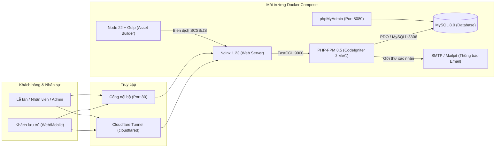
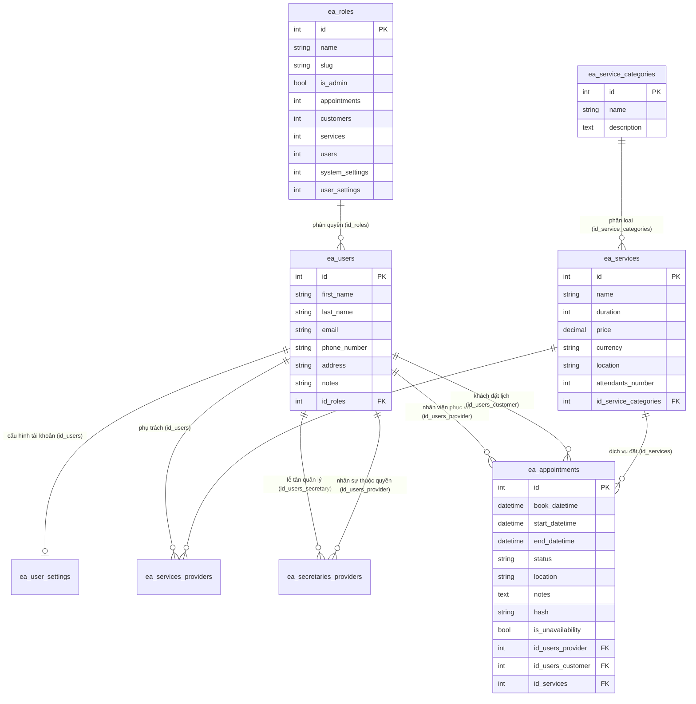
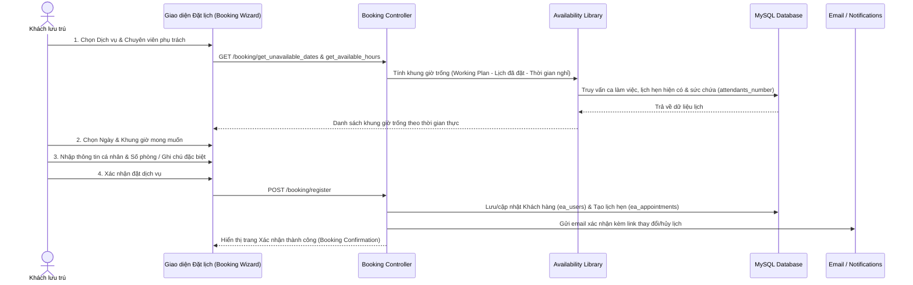

# BÁO CÁO HỆ THỐNG ĐẶT LỊCH & ĐIỀU PHỐI DỊCH VỤ NỘI KHU KHÁCH SẠN 5 SAO
**Đơn vị triển khai:** Grand Metropole Hotel & Resort  
**Nền tảng lõi:** Easy!Appointments (Tùy biến chuyên sâu cho nghiệp vụ Hotel Concierge & Resort)

---

## 1. Tổng quan Dự án

### 1.1. Bối cảnh & Bài toán
Tại các khách sạn và khu nghỉ dưỡng 5 sao, khách lưu trú phát sinh nhu cầu đặt trước nhiều dịch vụ nội khu cao cấp như: **nhận phòng đặc quyền (VIP Check-in), bàn tiệc Fine Dining, trà chiều, xe sang đưa đón sân bay, liệu trình Spa/Onsen, lều nghỉ Cabana bể bơi vô cực, sân thể thao và phòng họp VIP**.

Việc tiếp nhận thủ công qua điện thoại nội bộ hoặc sổ ghi chép tại quầy Lễ tân dễ dẫn đến:
- Trùng lặp khung giờ phục vụ hoặc quá tải năng lực của từng bộ phận/nhân sự.
- Thiếu sự phối hợp tức thời giữa Quầy Lễ tân (Front Desk / Concierge) và các Trưởng bộ phận chuyên môn (Butler, F&B, Spa, Đội xe, MICE).
- Khách hàng không chủ động tra cứu được khung giờ trống theo thời gian thực.

### 1.2. Mục tiêu Hệ thống
Xây dựng **Hệ thống Đặt lịch & Quản lý Dịch vụ Khách sạn 5 Sao (Hotel Concierge & Service Booking Management System)** nhằm:
1. **Số hóa trải nghiệm đặt dịch vụ cho khách lưu trú:** Giao diện sang trọng chuẩn 5 sao (Navy & Gold), cho phép đặt lịch trực tuyến qua 4 bước với khả năng tính toán khung giờ trống theo thời gian thực.
2. **Điều phối tập trung tại Back-Office:** Cung cấp lịch biểu trực quan (Ngày / Tuần / Tháng / Theo nhân sự) cho Lễ tân và Quản trị viên.
3. **Phân quyền chặt chẽ & Bảo mật hồ sơ khách VIP:** Đảm bảo mỗi bộ phận/nhân viên chỉ xem được khách hàng đặt dịch vụ do mình phụ trách và không được phép tự ý xóa hồ sơ khách hàng.

---

## 2. Kiến trúc Hệ thống & Công nghệ Sử dụng

### 2.1. Sơ đồ Kiến trúc Triển khai (Docker Compose)



### 2.2. Công nghệ Thành phần

| Tầng | Công nghệ / Công cụ | Vai trò trong Hệ thống |
| :--- | :--- | :--- |
| **Frontend** | HTML5, Bootstrap 5, SCSS, jQuery, FullCalendar, Flatpickr | Giao diện đặt lịch 4 bước cho khách & Lịch biểu kéo-thả tại Back-Office. |
| **Build Tool** | Node.js 22, Gulp, Babel | Tự động biên dịch và nén tài nguyên `.min.css`, `.min.js` trong thư mục `assets/`. |
| **Backend** | PHP 8.5-FPM, CodeIgniter 3 (Mô hình MVC) | Xử lý logic nghiệp vụ, kiểm soát phân quyền, tính toán khung giờ trống, REST API v1. |
| **Cơ sở dữ liệu** | MySQL 8.0 (`utf8mb4_unicode_ci`) | Lưu trữ người dùng, phân quyền, danh mục, dịch vụ, ca làm việc và lịch hẹn. |
| **Hạ tầng & Đóng gói** | Docker, Docker Compose, Nginx 1.23, Cloudflare Tunnel | Đóng gói đồng nhất môi trường phát triển & triển khai, hỗ trợ truy cập qua tên miền công khai. |

---

## 3. Phân quyền Người dùng & Bảo mật (RBAC)

Hệ thống quản lý quyền truy cập thông qua bảng `ea_roles` kết hợp với thư viện kiểm soát phạm vi dữ liệu `Permissions` (`application/libraries/Permissions.php`) và `Roles_model` (`application/models/Roles_model.php`).

### 3.1. Cơ chế Mã hóa Quyền (Bitmask)
Trong `application/config/constants.php`, mỗi tài nguyên được gán giá trị tổng của 4 quyền cơ bản:
- `PRIV_VIEW = 1` (Xem)
- `PRIV_ADD = 2` (Thêm mới)
- `PRIV_EDIT = 4` (Chỉnh sửa)
- `PRIV_DELETE = 8` (Xóa)

Ví dụ: Giá trị `15` (`1 + 2 + 4 + 8`) tương ứng toàn quyền; giá trị `7` (`1 + 2 + 4`) cho phép Xem, Thêm, Sửa nhưng **cấm Xóa**.

### 3.2. Ma trận Phân quyền Chi tiết

| Chức năng / Tài nguyên | Khách hàng (`customer`) | Nhân viên / Chuyên viên (`provider`) | Lễ tân / Điều phối (`secretary`) | Quản trị viên (`admin`) |
| :--- | :---: | :---: | :---: | :---: |
| **Đặt lịch trực tuyến (Trang chủ)** | Có | Có | Có | Có |
| **Lịch hẹn (`appointments`)** | Không (Chỉ xem qua link cá nhân) | Xem / Thêm / Sửa / Xóa *(Chỉ lịch của chính mình)* | Toàn quyền *(Trên các bộ phận được phân công)* | Toàn quyền hệ thống |
| **Hồ sơ Khách hàng (`customers`)** | Không | **Chỉ xem & cập nhật khách có lịch đặt với mình; KHÔNG được xóa khách (`customers = 7`)** | Xem, thêm, sửa, xóa & tra cứu toàn bộ khách lưu trú (`customers = 15`) | Toàn quyền (`customers = 15`) |
| **Dịch vụ & Danh mục (`services`)** | Không | Không (`0`) | Không (`0`) | Toàn quyền (`15`) |
| **Quản lý Nhân sự (`users`)** | Không | Không (`0`) | Không (`0`) | Toàn quyền (`15`) |
| **Cấu hình Hệ thống (`system_settings`)** | Không | Không (`0`) | Không (`0`) | Toàn quyền (`15`) |
| **Cài đặt Cá nhân (`user_settings`)** | Không | Toàn quyền (`15`) | Toàn quyền (`15`) | Toàn quyền (`15`) |

### 3.3. Chính sách Bảo vệ Dữ liệu Khách hàng đối với Nhân viên (`Provider`)
1. **Chặn quyền xóa khách hàng:** Vai trò `provider` có `customers = 7` trong bảng `ea_roles` và bị khóa cứng `$permissions[PRIV_CUSTOMERS]['delete'] = false` tại `Roles_model::get_permissions_by_slug()`. Nút xóa bị ẩn trên giao diện và mọi request gọi thẳng vào `Customers::destroy()` đều bị từ chối với mã `403 Forbidden`.
2. **Giới hạn phạm vi xem khách hàng:** Hàm `Permissions::has_customer_access()` bắt buộc kiểm tra bảng `ea_appointments` (`id_users_provider = $user_id`). Nhân viên chỉ nhìn thấy những khách hàng đã đặt dịch vụ do chính mình phụ trách trên cả trang **Khách hàng** và hộp thoại chọn khách trên **Lịch biểu**.

---

## 4. Thiết kế Cơ sở Dữ liệu

### 4.1. Sơ đồ Thực thể Liên kết (ERD)



### 4.2. Giải thích các Bảng Dữ liệu Cốt lõi
1. **`ea_roles`**: Định nghĩa 4 vai trò (`admin`, `provider`, `customer`, `secretary`) và điểm phân quyền bitmask cho từng phân hệ.
2. **`ea_users` & `ea_user_settings`**: Lưu thông tin hồ sơ của toàn bộ người dùng (Admin, Lễ tân, Nhân viên, Khách lưu trú) và thông tin đăng nhập (`username`, `password` băm Bcrypt), lịch làm việc riêng (`working_plan`), ngoại lệ nghỉ phép (`working_plan_exceptions`).
3. **`ea_service_categories` & `ea_services`**: Lưu 5 nhóm danh mục và 14 dịch vụ khách sạn (thời lượng phút, đơn giá VNĐ, vị trí phục vụ, màu sắc hiển thị trên lịch, số lượng khách phục vụ đồng thời `attendants_number`).
4. **`ea_services_providers`**: Bảng trung gian nhiều-nhiều ánh xạ nhân sự nào được phép thực hiện dịch vụ nào.
5. **`ea_secretaries_providers`**: Bảng trung gian phân quyền cho Lễ tân được phép điều phối lịch của những chuyên viên/bộ phận nào.
6. **`ea_appointments`**: Lưu cả lịch hẹn của khách (`is_unavailability = 0`) lẫn lịch bận/bảo trì của nhân viên (`is_unavailability = 1`), kèm trạng thái xử lý (`Đã đặt`, `Đã xác nhận`, `Khách đang sử dụng`, `Hoàn thành`, `Đã đổi lịch`, `Đã huỷ`).

---

## 5. Quy trình Nghiệp vụ Chính

### 5.1. Quy trình Khách lưu trú Đặt dịch vụ Trực tuyến



### 5.2. Quy trình Điều phối & Phục vụ tại Back-Office
1. **Tiếp nhận & Xác nhận (Lễ tân / Secretary):**
   - Lễ tân theo dõi bảng lịch tổng hợp tại `/calendar`, kiểm tra các lịch mới ở trạng thái `Đã đặt`, liên hệ xác nhận với khách hoặc bộ phận chuyên môn và chuyển trạng thái sang `Đã xác nhận`.
   - Khi khách gọi qua hotline hoặc yêu cầu trực tiếp tại sảnh, Lễ tân tạo lịch hẹn trực tiếp trên Lịch biểu và phân công cho Chuyên viên tương ứng.
2. **Thực hiện Dịch vụ (Nhân viên / Provider):**
   - Trưởng bộ phận / Chuyên viên đăng nhập tài khoản cá nhân, xem lịch phục vụ của riêng mình và thông tin các khách hàng đã đặt dịch vụ của mình (số phòng, ghi chú dị ứng, yêu cầu VIP...).
   - Cập nhật trạng thái lịch hẹn sang `Khách đang sử dụng` và `Hoàn thành` sau khi kết thúc.

---

## 6. Dữ liệu Nghiệp vụ Triển khai tại Grand Metropole Hotel & Resort

Hệ thống được nạp sẵn kịch bản dữ liệu thực tế thông qua script `docker/seed-hotel.php`:

### 6.1. 5 Nhóm Danh mục & 14 Dịch vụ Chuẩn 5 Sao
1. **Lưu trú, Nhận phòng VIP & Tham quan:**
   - Thủ tục Nhận phòng Đặc quyền (*VIP Club Lounge Check-in* – 30 phút – Miễn phí)
   - Gói Nghỉ dưỡng Trong ngày – *Deluxe Day-Use Suite* (240 phút – 2.200.000 VNĐ)
   - Trải nghiệm Tham quan Khách sạn & Tư vấn Hạng phòng (*Hotel Tour* – 45 phút – Miễn phí)
2. **Ẩm thực, Bàn tiệc & Trà chiều:**
   - Đặt bàn Tiệc tối Fine Dining – Nhà hàng Pháp *Le Beaulieu* (120 phút – 1.850.000 VNĐ)
   - Đặt bàn Buffet Hải sản & Tôm hùm Nướng – *The Verandah* (120 phút – 1.250.000 VNĐ)
   - Trà chiều Hoàng gia Anh (*Royal High Tea Set* – 90 phút – 790.000 VNĐ)
3. **Đưa đón Sân bay & Xe sang Limousine:**
   - Xe sang *Mercedes S450* Đón/Tiễn Sân bay Nội Bài 1 chiều (60 phút – 1.500.000 VNĐ)
   - Thuê xe *Limousine DCar* 9 chỗ Tham quan Phố cổ (180 phút – 2.800.000 VNĐ)
4. **Wellness, Spa, Bể bơi & Thể thao:**
   - Liệu trình Hoàng gia – Massage Đá nóng & Thảo mộc tại *Le Spa* (90 phút – 1.150.000 VNĐ)
   - Tổ hợp Xông hơi Đá muối Himalaya & Bồn sục *Onsen* (60 phút – 650.000 VNĐ)
   - Đặt lều nghỉ *Cabana* Riêng tư tại Bể bơi Vô cực tầng 20 (120 phút – 950.000 VNĐ)
   - Thuê Sân *Tennis / Pickleball* Tiêu chuẩn Quốc tế (60 phút – 550.000 VNĐ)
5. **Phòng Họp, Hội nghị & Sự kiện VIP:**
   - Thuê Phòng Họp Hội đồng VIP – *Executive Boardroom* (120 phút – 3.500.000 VNĐ)
   - Tư vấn & Khảo sát Sảnh Tiệc cưới / Hội thảo *Grand Ballroom* (60 phút – Miễn phí)

### 6.2. Danh sách Tài khoản Vận hành

| Vai trò | Họ tên & Chức danh | Tài khoản | Mật khẩu |
| :--- | :--- | :--- | :--- |
| **Quản trị viên (Admin)** | Đàm Quân – Tổng Quản lý Điều hành (General Manager) | `administrator` | `administrator` |
| **Lễ tân (Secretary)** | Phạm Lan Hương – Lễ tân Trưởng (Ca Sáng) | `lanhuong` | `12345678` |
| **Lễ tân (Secretary)** | Đỗ Minh Trang – Lễ tân Quốc tế (Ca Chiều) | `minhtrang` | `12345678` |
| **Nhân viên (Provider)** | Nguyễn Hoàng Bách – Quản gia Trưởng (Butler) | `hoangbach` | `12345678` |
| **Nhân viên (Provider)** | Trần Khánh Linh – Giám sát Khối Lưu trú | `khanhlinh` | `12345678` |
| **Nhân viên (Provider)** | Lê Bảo Sơn – Quản lý Nhà hàng & Sommelier | `baoson` | `12345678` |
| **Nhân viên (Provider)** | Vũ Thuỳ Dương – Trưởng nhóm Đón tiếp Nhà hàng | `thuyduong` | `12345678` |
| **Nhân viên (Provider)** | Đặng Quốc Trung – Trưởng bộ phận Concierge & Xe VIP | `quoctrung` | `12345678` |
| **Nhân viên (Provider)** | Bùi Mai Phương – Quản lý Le Spa & Wellness | `maiphuong` | `12345678` |
| **Nhân viên (Provider)** | Phan Gia Huy – Giám đốc Hội nghị & Sự kiện | `giahuy` | `12345678` |

---

## 7. Hướng dẫn Khởi chạy & Vận hành

```powershell
# 1. Di chuyển vào thư mục dự án và khởi chạy Docker Compose
cd c:\Users\Admin\Downloads\my-project\easyappointments
docker compose up -d

# 2. Chạy migration và nạp dữ liệu mẫu khách sạn (khi khởi tạo mới)
docker compose exec php-fpm php index.php console migrate
docker compose exec php-fpm php docker/seed-hotel.php
```

- **Trang đặt lịch cho Khách lưu trú:** `http://localhost/index.php`
- **Trang Quản trị & Điều phối (Back-Office):** `http://localhost/index.php/login`
- **Quản trị Cơ sở dữ liệu (phpMyAdmin):** `http://localhost:8080` (`root` / `secret`)

